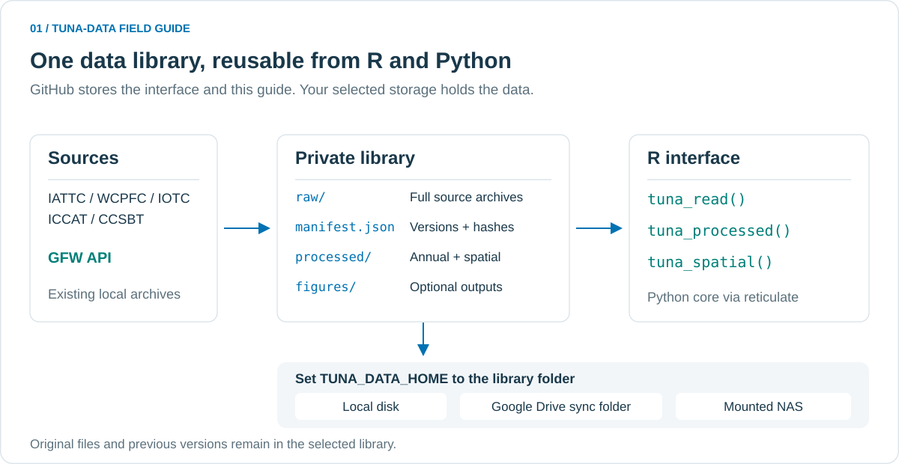
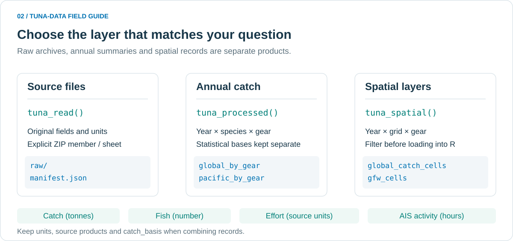
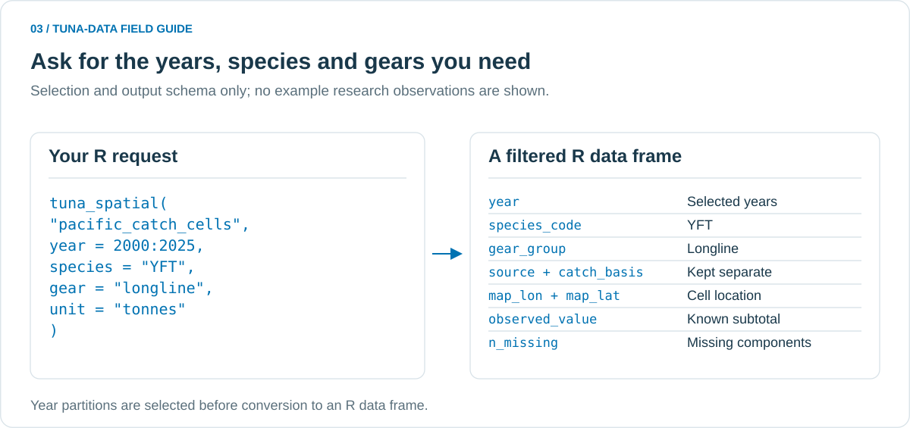
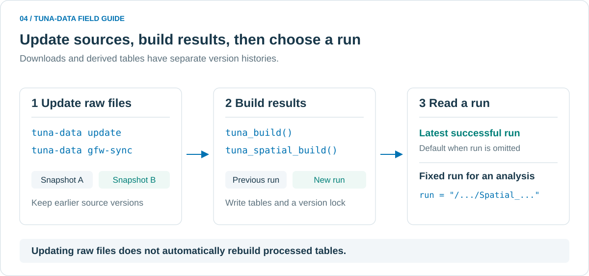
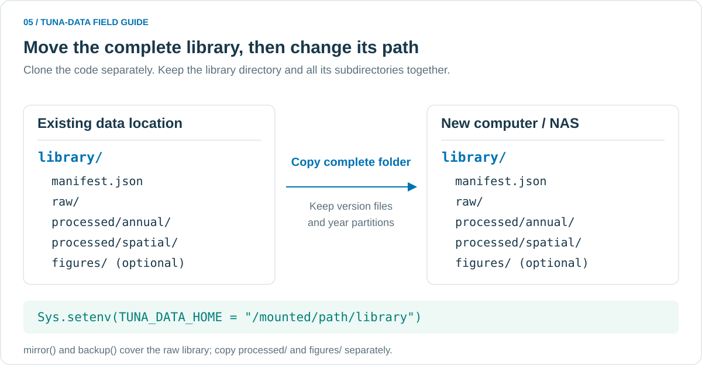
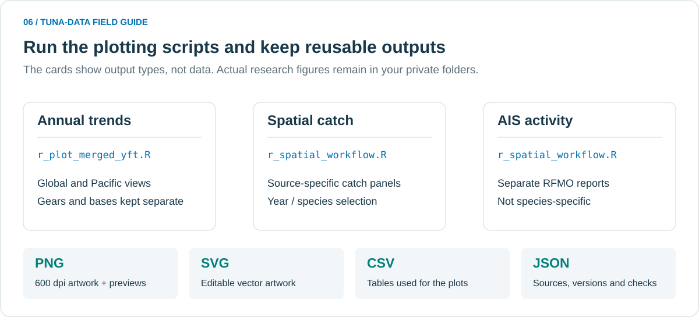

# tuna-data

**金枪鱼研究数据接口 · 图文使用手册**

用 Python 下载、保存和标准化 RFMO / GFW 数据，在 R 中按年份、鱼种、捕捞方式和海域读取。原始文件、年度合并表、空间明细和分析版本各自保留，同一套接口可以连接本地硬盘、Google Drive 同步目录或挂载的 NAS。

**GitHub 保存接口、模板、测试和本手册；研究数据保存在你指定的私有数据目录。** 下方配图说明目录结构、操作流程与返回字段，不包含研究观测值、个人路径或凭据。



*图 1 · 下载或导入一次，保留完整来源文件；后续研究通过同一套接口读取和复用清洗结果。*

| 我想做什么 | 从这里开始 |
|---|---|
| 第一次安装，或在 R 中连接已有数据 | [1. 快速开始](#quick-start) |
| 确认有哪些数据、应该读哪张表 | [2. 数据分层与目录](#data-layers) |
| 按年份、鱼种、渔具筛选空间数据 | [3. R 查询示例](#r-queries) |
| 补下载、重新清洗、固定论文分析版本 | [4. 更新与复现](#update-and-freeze) |
| 换电脑，使用 Google Drive 或 NAS | [5. 存储与迁移](#storage-and-migration) |
| 画年度趋势图和空间分布图 | [6. 绘图与输出](#plotting) |
| 查来源、排错或使用 Python / 命令行 | [7. 来源与范围](#sources) · [8. 常见问题](#troubleshooting) · [9. 进阶参考](#reference) |

<a name="quick-start"></a>

## 1. 快速开始：在 R 中连接已有数据

### ① 安装接口：每台新电脑执行一次

先安装 R 和 Python。R 安装脚本支持已安装的 Python **3.11–3.13**，推荐 3.12。把整个仓库下载到电脑，或在终端运行：

```bash
git clone https://github.com/Linbojun99/tuna_data.git
```

在 R 中将 `repo` 改为实际代码目录：

```r
repo <- "/你的代码目录/tuna_data"
source(file.path(repo, "examples", "r_setup.R"))
```

安装脚本创建独立的 `~/.venvs/tuna-data` Python 环境，安装接口、Excel/Parquet 读取依赖和 R 的 `reticulate`。它只安装程序，不下载研究数据。接口以 editable 方式安装，**请保留代码仓库目录**；更新代码后重启 R，使新代码生效。

### ② 指定数据目录：每个研究脚本的开头

下面的 `library` 应是已经复制或同步到本机的完整数据目录，里面含有 `manifest.json` 和 `raw/`。使用清洗结果还需有 `processed/`。

```r
repo <- "/你的代码目录/tuna_data"
Sys.setenv(TUNA_DATA_HOME = "/你的数据目录/library")

# 使用上一步创建的 Python 环境；兼容 macOS、Linux 和 Windows。
python_rel <- if (.Platform$OS.type == "windows") "Scripts/python.exe" else "bin/python"
Sys.setenv(RETICULATE_PYTHON = file.path(path.expand("~/.venvs/tuna-data"), python_rel))
source(file.path(repo, "R", "tuna_data.R"))

# 检查实际连接位置和原始库索引。
tuna_library()$root$as_posix()
file.exists(file.path(Sys.getenv("TUNA_DATA_HOME"), "manifest.json"))
```

读取已有库时，最后一行应返回 `TRUE`。路径指向 `library` 本身，不是它下面的 `raw` 子目录，也不是 Drive 网页地址。尚无数据时，可选定空目录后按[第 4 节](#update-and-freeze)下载并构建。

> **Python 环境须在首次加载 Python 前设置。** 如果 R 已经加载另一个 Python，请重启 R 再运行上面代码。若安装时自定义过环境位置，将 `RETICULATE_PYTHON` 改成那个环境的可执行文件路径。

### ③ 查看可用数据，再读取

```r
# 原始文件目录：来源、数据集 ID、文件名和版本等。
catalogue <- tuna_catalog()
head(catalogue[c("id", "source", "filename")])

# 已构建的空间数据目录：实际年份、鱼种、渔具、单位与覆盖信息。
available <- tuna_spatial_catalog()
head(available[c("year", "source", "species_code", "gear_group", "unit")])
```

`tuna_spatial_catalog()` 需要已保存的空间清洗结果。没有结果时先运行[全部年份构建](#update-and-freeze)。查询返回 R `data.frame`，可以继续用 `subset()`、`dplyr` 或 `ggplot2`。

也可以直接运行仓库里的完整示例：

| 脚本 | 执行后得到什么 | 是否构建或更新 |
|---|---|---|
| [r_quickstart.R](examples/r_quickstart.R) | 原始目录、完整 IATTC 小表及大表预览 | 仅读取，不下载 |
| [r_spatial_all_years.R](examples/r_spatial_all_years.R) | 历史覆盖目录、RFMO 与 GFW 筛选示例 | 有全部年份结果则读取，否则从已有原始文件构建 |
| [r_clean_merge.R](examples/r_clean_merge.R) | 全球与太平洋年度标准化、合并结果 | 从已有原始文件构建，不重新下载 |

<a name="data-layers"></a>

## 2. 数据分层：先选对表，再做分析



*图 2 · 原始文件适合核对来源；年度表适合长期趋势；空间表适合分布分析。不同单位和统计口径始终保留。*

| 数据层 | R 调用 | 主要用途 |
|---|---|---|
| 完整原始文件与来源索引 | `tuna_catalog()`、`tuna_members()`、`tuna_read()` | 查字典、核对原字段，复用已有 CSV / Excel / ZIP / Access 文件 |
| 全球 / 太平洋年度分渔具汇总 | `tuna_processed("global_by_gear")`、`tuna_processed("pacific_by_gear")` | 按年份、鱼种、渔具和 `catch_basis` 分析趋势 |
| 全球 / 太平洋空间渔获网格 | `tuna_spatial("global_catch_cells")`、`tuna_spatial("pacific_catch_cells")` | 保留来源与口径的渔获分布 |
| RFMO 原始粒度标准化明细 | `tuna_spatial("rfmo_native", ...)` | 核对原始时空粒度、代码、缺失和来源行 |
| RFMO 努力量网格 | `tuna_spatial("rfmo_effort_cells", ...)` | 分单位研究 hooks、sets 等努力量 |
| GFW 网格 / 标准化明细 | `tuna_spatial("gfw_cells", ...)`、`tuna_spatial("gfw_native", ...)` | 研究 RFMO 区域内 AIS 推断捕鱼活动时数 |

**渔获吨数、鱼尾数、努力量和 GFW 捕鱼时数是不同指标。** 年度合并仍保留保留渔获、登陆量、丢弃量及 WCPFC 年鉴等统计口径；空间采样数据不等于完整年度总量。

<details>
<summary>展开：读取原始表和 ZIP 内文件</summary>

```r
subset(tuna_catalog(), source == "iotc")

# 小表完整读取。
catch_raw <- tuna_read("iattc/catchbyflaggear")
head(catch_raw)

# 多文件 ZIP 先列出成员，再明确选择一张表。
tuna_members("wcpfc/820")
ll_preview <- tuna_read(
  "wcpfc/820", member = "WCPFC_L_PUBLIC_BY_YY_MM.csv", nrows = 1000L
)
```

`nrows = 1000L` 只限制本次预览，不改变已保存的完整原始文件。去掉它可完整读取，需预留相应内存。CSV 默认保留字符串代码、前导零、`NA` 和保密标志；不要对全部字段直接做数值转换。Python 的 `clean_columns()`、`numeric_columns()` 可用于明确指定列的清洗。

</details>

<a name="r-queries"></a>

## 3. R 查询：按年份、鱼种和捕捞方式筛选



*图 3 · 左侧是查询条件，右侧是返回字段。图中仅展示接口和字段含义，实际行数与覆盖取决于选定版本。*

### 太平洋黄鳍金枪鱼：多年、分渔具、吨数

先执行第 1 节的 R 初始化代码，并确认已构建全部年份结果：

```r
yft <- tuna_spatial(
  "pacific_catch_cells",
  year = 2000:2025,
  species = "YFT",
  gear = c("longline", "purse_seine"),
  unit = "tonnes"
)
head(yft[c("year", "source", "catch_basis", "gear_group",
           "map_lon", "map_lat", "observed_value", "n_missing")])

# 同样的筛选条件可用于全球视图。
yft_global <- tuna_spatial(
  "global_catch_cells", year = 2024, species = "YFT", unit = "tonnes"
)
```

`2000:2025` 表示连续年份；`c(2000, 2025)` 只选两个年份。省略 `year` 读取该结果中全部可用年份，省略其他筛选条件则保留对应全部类别。示例区间不保证每家来源、每种渔具在每一年都有数据；先查 `available`，不要把没有记录的年份补成零。

标准模板的七种主要金枪鱼：

| 代码 | English name | 中文名 |
|---|---|---|
| `YFT` | Yellowfin tuna | 黄鳍金枪鱼 |
| `BET` | Bigeye tuna | 大眼金枪鱼 |
| `SKJ` | Skipjack tuna | 鲣 |
| `ALB` | Albacore | 长鳍金枪鱼 |
| `PBF` | Pacific bluefin tuna | 太平洋蓝鳍金枪鱼 |
| `BFT` | Atlantic bluefin tuna | 大西洋蓝鳍金枪鱼 |
| `SBF` | Southern bluefin tuna | 南方蓝鳍金枪鱼 |

RFMO 标准渔具包括 `longline`、`purse_seine`、`pole_and_line`、`gillnet`、`handline` 等。可用值以目录为准：

```r
unique(available[c("source", "species_code", "gear_group", "unit")])
subset(available, source == "iotc" & species_code == "YFT")
```

### 核对明细，或只读需要的列

```r
native_yft <- tuna_spatial(
  "rfmo_native", year = 2024, species = "YFT", source = "iattc",
  gear = "longline", unit = "tonnes", measure = "catch"
)

cells_small <- tuna_spatial(
  "global_catch_cells", year = 2024, species = "YFT", unit = "tonnes",
  columns = c("year", "source", "catch_basis", "gear_group",
              "map_lon", "map_lat", "observed_value", "n_missing")
)
```

结果按年保存；读取时先选择年份分区并应用筛选，再转换成 R 表。大规模 `*_native` 表建议先限定年份和来源。

### GFW：区域、年份与活动类型

```r
gfw <- tuna_spatial(
  "gfw_cells", year = 2020:2026, rfmo = "IOTC",
  gear = "drifting_longlines", include_partial = TRUE
)

# 查看报告实际覆盖到哪一天。
gfw_coverage <- tuna_spatial("gfw_coverage", rfmo = "IOTC")
head(gfw_coverage[c("year", "report_start", "report_end_exclusive",
                    "available_through", "period_status")])
```

GFW 的 `gear` 使用其自身类别，例如 `drifting_longlines`，与 RFMO 标准渔具名不同。**GFW 没有鱼种字段，不支持 `species` 筛选**；这些记录表示区域内 AIS 推断的 apparent fishing hours，并非金枪鱼渔获量。设 `include_partial = FALSE` 可排除标记为部分年度的记录。

| 字段 / 标记 | 如何理解 |
|---|---|
| `source` / `rfmo` | `source` 是数据提供方；GFW 的 `rfmo` 是报告使用的区域 |
| `catch_basis` | 渔获统计口径；合并和绘图时继续保留 |
| `observed_value` | 已知记录的小计；有缺失组成时不能据此宣称完整总量 |
| `value` / `n_missing` | 聚合含缺失组成时 `value` 保持缺失；`n_missing` 显示缺失数量 |
| `period_status` | `full_calendar_year`、`partial_year` 或 RFMO 的 `source_reported`；后者不承诺全年完整采样 |
| `report_end_exclusive` | 请求区间不包含的结束日期；`available_through` 是对应的最后包含日期 |

保留源网格和原始时间粒度，不将粗网格伪装成细网格。不同 RFMO 的 GFW 区域可能重叠，不能直接相加。空间汇总和太平洋划分依据见[空间方法文档](docs/spatial_pipeline.md)。

<a name="update-and-freeze"></a>

## 4. 更新与复现：下载、构建、读取是三个步骤



*图 4 · 原始文件更新后，需要重新构建才能得到新的清洗表。论文分析可固定某次成功结果，避免随最新数据变化。*

### ① 补下载与更新原始文件

在完成第 1 节的 R 初始化后：

```r
# 五家 RFMO：自动发现官网当前公开文件，下载、校验并保留历史版本。
tuna_update()

# GFW：补齐 2012 年起、五家 RFMO 区域的可用报告。
gfw_api <- reticulate::import("tuna_data.gfw", convert = TRUE)
gfw_api$sync(library = tuna_library())
```

新增 GFW 下载从环境变量 `GFW_TOKEN` 或本机 `~/.config/tuna-data/gfw-token` 读取 token，也可用 `GFW_TOKEN_FILE` 指定文件。凭据放在数据目录和 Git 仓库之外；**读取已有文件无需 token**。首次下载完整历史报告可能耗时较长，中断后重跑会复用已完成且校验通过的文件。

### ② 生成年度合并表与全部年份空间结果

```r
annual_run <- tuna_build(config = file.path(repo, "templates", "annual_catch.toml"))
spatial_run <- tuna_spatial_build(
  config = file.path(repo, "templates", "spatial_all_years.toml")
)
spatial_run$run_dir
```

这一步从已有原始文件构建，不触发下载。全部年份配置按各来源的实际年份展开；GFW 当前年若只有部分日期，会保留并明确标记。重叠的同年 GFW 报告按配置选择一份有效报告，其他原始版本仍保存在库中，不重复计入清洗结果。

默认结果位于 `library/processed/annual/` 和 `library/processed/spatial/`，每次构建产生独立运行目录。只有构建成功才更新 `latest.json`。每个结果保留配置、来源版本、SHA-256、质量检查和 `recipe.lock.toml`。

### ③ 日常读最新，论文分析固定版本

```r
# 默认读取当前库最近一次成功结果。
annual_by_gear <- tuna_processed("global_by_gear")

# 将这次 run_dir 写入自己的研究脚本，后续一直读取同一版本。
frozen_run <- spatial_run$run_dir
frozen_yft <- tuna_spatial(
  "pacific_catch_cells", run = frozen_run,
  year = 2024, species = "YFT", unit = "tonnes"
)

# 如需从保留的原始版本重建，使用该运行目录里的版本锁：
# tuna_spatial_build(config = file.path(frozen_run, "recipe.lock.toml"))
```

年度结果同样支持 `tuna_processed("global_by_gear", run = annual_run$run_dir)`。换电脑后，固定运行目录的路径也要改为新位置，并保留该目录全部文件和子目录。

<details>
<summary>展开：等价命令行、历史刷新与自动化入口</summary>

```bash
# 查看官网当前可下载目录，不下载大文件。
tuna-data discover all

# 更新原始文件。
tuna-data update
tuna-data gfw-sync

# 从完整原始库构建。
tuna-data build --config templates/annual_catch.toml
tuna-data build-spatial --config templates/spatial_all_years.toml

# GFW 同一版本也可能修订历史；明确刷新时保留旧文件。
tuna-data gfw-sync --refresh
```

GFW 报告按次序请求。网关超时会尝试取回同一报告，进度记录在库内；重跑同一命令可恢复。避免同一 token 同时提交其他报告。

[scripts/update_private.py](scripts/update_private.py) 可串联 RFMO 更新、可选 GFW 更新和原始库镜像；它**不自动重建 `processed/`**。完整自动化需在更新成功后再执行上面的两条构建命令。可接入实验室已有的 cron / NAS 任务计划，仓库默认不启用定时任务。

</details>

<a name="storage-and-migration"></a>

## 5. Google Drive、换电脑与 NAS



*图 5 · 先移动完整数据目录，再切换路径。代码和数据分开迁移；清洗结果需保留运行目录与年份分区。*

### 两个目录，各司其职

| 目录 | 内容 | 换电脑时如何处理 |
|---|---|---|
| `tuna_data/` 代码仓库 | R / Python 接口、模板、示例、文档 | 从 GitHub 下载或 `git clone`，重新安装环境 |
| `library/` 数据目录 | `manifest.json`、`raw/`、GFW 元数据、`processed/`，以及自行保存的图表 | 私有 Drive 同步，或从硬盘 / NAS 复制完整目录 |

路径优先级：**调用参数 `path=` > `TUNA_DATA_HOME` > 配置文件 > 默认目录**。长期配置可将 [config.example.toml](config.example.toml) 复制到 `~/.config/tuna-data/config.toml` 并修改 `[storage].root`，也可用 `TUNA_DATA_CONFIG` 指定其他配置文件。

### 换电脑 / NAS 的三个步骤

1. 在新电脑下载代码，按第 1 节运行 `r_setup.R`。
2. 在原库没有写入任务时，**同步或复制整个 `library` 目录**；保留所有原始版本、`processed/`、`latest.json` 和运行目录子文件。等待同步完成。
3. 在操作系统中挂载 NAS 或准备 Drive 本地同步目录，设置新的 `TUNA_DATA_HOME`，再读取。

| 存储位置 | 路径示例（请按实际位置修改） |
|---|---|
| 本地硬盘 | `D:/research/tuna-library` |
| Google Drive 桌面同步目录 | `/你的Drive同步目录/tuna-data-library/library` |
| macOS NAS | `/Volumes/NAS/research/tuna-library` |
| Linux NAS | `/mnt/lab-nas/tuna-library` |
| Windows NAS 映射盘 | `Z:/research/tuna-library` |

```r
# 已完成 R 初始化；NAS 上也已保存完整 library。
Sys.setenv(TUNA_DATA_HOME = "/Volumes/NAS/research/tuna-library")
stopifnot(file.exists(file.path(Sys.getenv("TUNA_DATA_HOME"), "manifest.json")))

yft_nas <- tuna_spatial(
  "pacific_catch_cells", year = 2024, species = "YFT", unit = "tonnes"
)

# 单次访问另一位置，不改变默认设置：
# tuna_read("iattc/catchbyflaggear", path = "D:/research/tuna-library")
```

Drive 网页链接不能作为文件路径。使用 Drive 桌面同步时，将需要的目录设为可离线使用，等待完整下载；有访问权限的账号即可同步，无需公开链接。Linux 可使用另行配置的私有 Drive `rclone` 同步到本地目录。

`Sys.setenv()` 只影响当前 R 会话。可把路径写在研究脚本开头，或把 `TUNA_DATA_HOME="/你的数据目录/library"` 写入 `~/.Renviron` 后重启 R。仅切换数据路径无需重启 R；已有 `db` 对象需要重新创建，`tuna_*()` 封装会在每次调用时同步路径设置。

### 完整迁移与原始库备份的区别

| 操作 | 包含什么 | 使用场景 |
|---|---|---|
| 文件系统复制 / Drive 同步整个 `library/` | 原始库、历史版本、年度及空间清洗结果，以及库内其他文件 | **换电脑后直接继续研究** |
| `tuna-data mirror` / `db$mirror()` | 原始文件、历史版本和库索引；不包含 `processed/` 与绘图输出 | 原始库增量镜像，保留目标已有内容 |
| `tuna-data backup` / `restore` | 带校验的原始库版本包；不包含 `processed/` 与绘图输出 | 原始库离线备份、恢复 |

若使用 `mirror` 或 `backup` 迁移，**还需单独复制完整 `processed/` 与所需图表**，或者在目标机器重新构建。绘图脚本默认输出在代码目录的 `reports/figures/`，不自动进入 `library`；这些图也要另行同步。

```bash
# 原始库镜像与版本包：请先设置源库路径。
tuna-data mirror "/Volumes/NAS/research/tuna-library"
tuna-data backup /备份位置/tuna-raw-backup.zip
tuna-data --root /新电脑/tuna-library restore /备份位置/tuna-raw-backup.zip
```

原始文件使用来源、产品、年份等可读名称，目录末尾保留版本校验值；接口通过 `manifest.json` 定位文件，不依赖手写文件名。不要脱离索引手动批量改名。

同一份 Drive 同步库由一台机器负责更新，其他机器读取；文件同步不能提供跨机器事务锁。等待数据和索引同步完成再在另一台机器读取。

<a name="plotting"></a>

## 6. 绘图与输出：年度趋势、空间渔获、GFW 活动



*图 6 · 每张研究图对应绘图数据与版本记录。这里展示输出类型，实际图像生成到你的私有输出目录。*

| 脚本 | 生成内容 | 默认输出位置（代码仓库内，已被 Git 忽略） |
|---|---|---|
| [r_plot_merged_yft.R](examples/r_plot_merged_yft.R) | 全球与太平洋 YFT 年度变化；分渔具、分统计口径 | `reports/figures/merged_yft/` |
| [r_spatial_workflow.R](examples/r_spatial_workflow.R) | 全球 / 太平洋空间渔获与独立 GFW 面板 | `reports/figures/spatial/` |
| [r_plot_catch_and_gfw.R](examples/r_plot_catch_and_gfw.R) | IATTC YFT 年度曲线与单一区域完整年度 GFW 地图 | `reports/figures/` |

首次安装绘图依赖后，沿用第 1 节的 `repo` 和数据路径：

```r
install.packages(c("ggplot2", "patchwork", "sf", "rnaturalearth", "rnaturalearthdata",
                   "ragg", "svglite", "systemfonts", "jsonlite", "scales"))

# 前提：已经构建年度合并结果。
source(file.path(repo, "examples", "r_plot_merged_yft.R"))

# 前提：空间结果中有该年份。换年份 / 鱼种只改这两项。
Sys.setenv(TUNA_SPATIAL_YEAR = "2024", TUNA_SPATIAL_SPECIES = "YFT")
source(file.path(repo, "examples", "r_spatial_workflow.R"))
```

空间脚本优先读取已有结果；没有结果时默认构建 2024 年示例。要绘制其他年份，先按第 4 节构建全部年份，或设置 `TUNA_SPATIAL_CONFIG` 指向自己的配置。`TUNA_SPATIAL_YEAR` 只控制绘图选择，不会自动补下载或扩充构建范围。

年度合并图默认选择预期来源都有记录的共同年份；较新但来源不足的年份保留在数据中，图中不补齐。全球图按实际海域和统计口径分面，不能把每个面板当成独立的完整全球总量。缺失年份断线、不补零、不平滑。

默认样式为英文图例、坐标轴与说明，白底、细线、统一无衬线字体及色觉友好配色。**地图仅显示海岸线，不显示国境线。** GFW 使用明确标记单位和对数变换的连续色标，未记录网格留空，不解释为没有捕鱼。

输出包括高分辨率 PNG、可编辑 SVG、绘图汇总 CSV、来源与 SHA-256 的 JSON 记录及 R 环境信息；合并年度图和空间图另有轻量预览 PNG。可通过脚本开头列出的 `TUNA_YFT_OUT`、`TUNA_SPATIAL_OUT` 或 `TUNA_PLOT_OUT` 改变输出位置。

<a name="sources"></a>

## 7. 数据来源、覆盖与统计范围

| 来源 | 下载适配范围 | 官方入口 |
|---|---|---|
| IATTC | 总渔获、围网、延绳钓、竿钓、兼捕和体长文件 | [Public domain](https://www.iattc.org/en-US/Data/Public-domain) |
| WCPFC | 聚合 C&E、年鉴原始文件、ACE 可选年份 / 船队 / 渔具文件及兼捕下载 | [Scientific data](https://www.wcpfc.int/sustainability/scientific-data) |
| IOTC | 年度保留渔获、catch/effort、体长、参考表及索引页其他文件 | [Datasets](https://iotc.org/data/datasets) |
| ICCAT | Task 1 / 2、CATDIS、EFFDIS、体长 / 年龄产品、目录及标志数据下载 | [Statistical databases](https://www.iccat.int/en/accesingdb.html) |
| CCSBT | 总渔获、分洋区 / 网格渔获、延绳钓与表层作业、体长、ERS、CDS/TIS | [SBT data](https://www.ccsbt.org/en/content/sbt-data) |
| GFW | RFMO 区域 AIS 推断捕鱼活动；月度、0.1°、船旗 × 渔具报告 | [4Wings reports](https://api-doc.globalfishingwatch.org/our-apis/documentation/docs/v3/4wings/report) |

**下载范围大于标准清洗范围。** 原始库完整保留受支持入口中已下载的文件、字典与说明；标准模板只对已实现并验证的表、七种主要金枪鱼及相应活动层做规范化。其他原始产品仍可用 `tuna_read()` 读取。

“全部可用年份”指受支持源文件内实际存在的年份，不表示各 RFMO 全部内部记录、未公开数据或所有历史评估材料。官网断链、未更新栏目或下载失败会记录到 `last_update.json`，更新命令返回非零状态，不会报告为完整成功。具体覆盖查看 `source_years`、`coverage` 和 `gfw_coverage`。

- [年度清洗方法](docs/cleaning_pipeline.md)：字段、渔具映射、物种 / 海域去重、统计口径和质量检查。
- [空间清洗方法](docs/spatial_pipeline.md)：源粒度、年份分区、太平洋划分、GFW 重叠报告与部分年度。
- [项目绘图约定](AGENTS.md)：英文标注、海岸线、可复现输出和私有数据管理。

读取 ICCAT Task 2 的 Access 数据库还需 `mdbtools`：macOS 使用 `brew install mdbtools`，Debian/Ubuntu 使用 `sudo apt-get install mdbtools`。下载、保存原始数据库不需要此工具。

<a name="troubleshooting"></a>

## 8. 常见问题

| 现象 | 处理方法 |
|---|---|
| `No module named tuna_data` / 加载了错误的 Python | 运行 `r_setup.R`；重启 R，在首次加载前设置 `RETICULATE_PYTHON` |
| 能看到 `raw/`，却读不到年度或空间表 | 检查 `processed/` 是否同步；若尚未构建，执行第 4 节 |
| `coverage` 有数据，但只有 2024 年 | 当前结果可能来自单年示例；构建 `spatial_all_years.toml`，或用 `run=` 指向已有历史结果 |
| 迁移到 NAS 后原始表可读、清洗表找不到 | `mirror/backup` 只处理原始库；单独复制完整 `processed/` 或重建 |
| 大表读取占用很多内存 | 先筛选 `year`、来源、鱼种和渔具；需要时用 `columns` 限定列 |
| GFW 不能按 YFT / BET 筛选 | GFW 活动数据没有鱼种；使用 RFMO 渔获层研究物种分布 |
| 最新年份不完整，或某年没有记录 | 查 `source_years`、`gfw_coverage` 与 `period_status`；不要补零或直接与完整年比较 |
| `value` 为缺失，但 `observed_value` 有数值 | 存在缺失组成；结合 `n_missing` 和质量表判断，不将已知小计当完整总量 |
| ZIP 要求选择成员 | 先用 `tuna_members(id)` 列表，再把确切文件名传入 `member=` |
| 文件缺失或 SHA-256 校验失败 | 确认 Drive 已完整同步；从完整副本恢复或重新下载该版本，不绕过校验继续研究 |
| GFW 报告超时 / 任务中断 | 重跑同一同步命令以恢复；避免另一个程序同时使用该 token 提交报告 |

<a name="reference"></a>

## 9. Python、命令行与维护参考

<details>
<summary>展开：Python 独立安装与查询</summary>

```bash
cd tuna_data
python3 -m venv .venv
# macOS / Linux：
source .venv/bin/activate
# Windows PowerShell：.venv\Scripts\Activate.ps1
python -m pip install -e '.[excel,parquet]'
```

```python
from tuna_data import Library
from tuna_data.spatial import read_spatial

library = Library("/你的数据目录/library")
print(library.catalog()[["id", "source", "filename"]].head())
yft = read_spatial(
    "pacific_catch_cells", library=library,
    year=list(range(2000, 2026)), species=["YFT"],
    gear=["longline", "purse_seine"], unit=["tonnes"],
)
print(yft.head())
```

已有文件可导入登记，原文件保持不变；也可以导出表格供不使用 reticulate 的 R 环境读取：

```bash
tuna-data import /路径/原始.zip --id iotc/my_archive
tuna-data export iattc/catchbyflaggear /输出位置/catch.csv
```

R 读取原始代码时可用 `read.csv(..., colClasses = "character", na.strings = NULL)`。更多年度处理见 [python_clean_merge.py](examples/python_clean_merge.py)。

</details>

| 模板 / 接口 | 用途 |
|---|---|
| [annual_catch.toml](templates/annual_catch.toml) | 全球与太平洋年度合并 |
| [pacific_catch.toml](templates/pacific_catch.toml) | 仅太平洋年度视图 |
| [spatial_all_years.toml](templates/spatial_all_years.toml) | 全部可用年份空间处理，按年保存 |
| [spatial_2024.toml](templates/spatial_2024.toml) | 单年空间模板，便于修改后试运行 |
| [R/tuna_data.R](R/tuna_data.R) | R 函数签名、筛选参数与路径规则 |

<details>
<summary>展开：开发验证与配图重建</summary>

```bash
python -m pip install -e '.[test,excel,parquet]'
pytest -q
Rscript tests/test_r_paths.R

# 仅使用 Python 标准库，重建本手册的六张 SVG 说明图。
python scripts/build_readme_assets.py
```

测试使用合成数据，覆盖版本固定、损坏检测、ZIP 选择、迁移、路径切换、缺值 / 零值、年度与空间合并规则和版本锁重放。GitHub Actions 不访问个人数据目录或 token。

手册配图源代码位于 [build_readme_assets.py](scripts/build_readme_assets.py)，SVG 保存在 [docs/assets](docs/assets)。配图是流程与接口说明；实际研究图由第 6 节脚本从私有数据生成。

</details>
