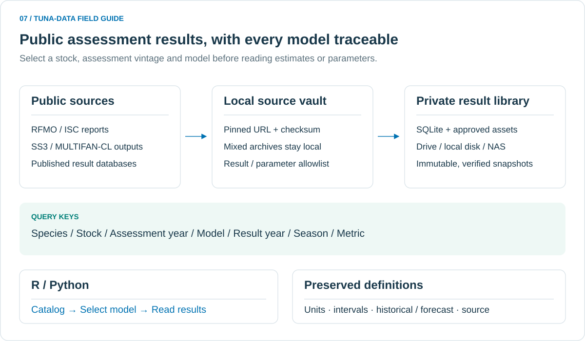

# 公开资源评估数据库使用手册

这个数据库整理 **7 种主要金枪鱼、23 个种群**的公开评估结果。一个物种可以对应多个海域、评估年份和模型情景；这些维度全部保留，不默认混合或平均。

2026-11-12 构建的快照包含 **806 个模型/报告结果单元**（778 个机器可读模型、28 个报告结果单元）、5,954,486 条时间序列记录、90,909 条参数记录、6,238 条参考点记录，以及 864 个经过筛选的参数/代码文件。来源清单包含 1,035 个公开文件。数量用于识别本次快照，不代表已穷尽网上所有历史评估；每个种群的实际覆盖以 `coverage` 表为准。

只纳入可独立访问的公开评估数据库、模型结果、参数和代码，以及评估报告中明确列出的数值。**不读取或使用个人 CPUE；不上传 logbook、观测输入、混合原包或完整混合报告。** GitHub 保存接口、来源配方和说明书；实际数据库与允许的参数/代码资产保存在你的本地、私人 Drive 或 NAS。



## 1. 从哪里开始

| 要做什么 | 入口 |
|---|---|
| 从头运行完整示例 | [`examples/r_assessment_database.R`](../examples/r_assessment_database.R) |
| 首次安装 Python + R 接口 | [`examples/r_setup.R`](../examples/r_setup.R) |
| 查看公开下载来源及提取规则 | [`templates/assessment_public.json`](../templates/assessment_public.json) |
| Python 读取与管理接口 | [`src/tuna_data/assessment/`](../src/tuna_data/assessment/) |
| 捕捞量清洗与合并 | [捕捞量流程](cleaning_pipeline.md) |
| 空间捕捞与 GFW 活动 | [空间数据流程](spatial_pipeline.md) |

在 RStudio 中运行，代码路径改成你克隆的仓库位置：

```r
# 新机器仅需先安装一次
source("/你的代码目录/tuna_data/examples/r_setup.R")

# 设置自己的数据位置，然后运行完整示例
Sys.setenv(TUNA_DATA_HOME = "/你的Drive同步目录/tuna-data-library/library")
source("/你的代码目录/tuna_data/examples/r_assessment_database.R")
```

示例依次展示覆盖表、模型目录、季度生物量、参数、参考点、原生输出段和报告数值，并在代码目录的 `local/assessment-preview/` 中生成实际数据的 PNG/PDF 预览。它不会下载新数据或执行提供方模型代码。

已经安装好环境时，可直接加载接口：

```r
Sys.setenv(RETICULATE_PYTHON = "~/.venvs/tuna-data/bin/python")
source("/你的代码目录/tuna_data/R/tuna_data.R")
```

Windows 的 Python 路径通常为 `C:/Users/你的用户名/.venvs/tuna-data/Scripts/python.exe`。若 R 已经启动另一个 Python，先重启 R，再指定环境。

Python 可以直接使用同一份数据库：

```python
from tuna_data import Library
from tuna_data.assessment import assessment_catalog, read_assessment

library = Library("/你的数据目录/tuna-data-library/library")
models = assessment_catalog(library=library, species="BET", stock="EPO-BET",
                            assessment_year=2024, model_name="Fix-1-1")
assert len(models) == 1
ssb = read_assessment("series", library=library,
                      model=models.iloc[0].model_id,
                      metric="spawning_quantity", section="DERIVED_QUANTITIES:SSB",
                      year=list(range(2000, 2024)))
print(ssb[["year", "season", "value", "unit"]].head())
```

## 2. 数据包含什么

| 表 | 内容 | 典型筛选 |
|---|---|---|
| `coverage` | 每个种群的模型数量、评估版本和数据年份范围 | `species`, `stock` |
| `models` | 模型名称、模型类型、情景角色、时间定义、限定说明 | `species`, `stock`, `assessment_year`, `model_name` |
| `series` | 生物量、繁殖量、补充量、F、相对资源状态等估计 | `model`, `year`, `season`, `region`, `metric`, `section` |
| `parameters` | 估计参数、标准误、年龄相关生物学参数 | `model`, `metric` |
| `reference_points` | MSY、未开发状态、参考点及其他派生量 | `model`, `metric` |
| `diagnostics` | 可识别的模型收敛与运行诊断 | `model` |
| `sections` | 允许保存的原生结果段索引 | `model` |
| `files` | 已筛选的公开参数和代码文件 | `stock`, `model`, `assessment_year` |
| `sources` | 公开 URL、文件校验值、下载时间 | `source` |
| `exclusions` | 未纳入共享库的文件/段落及原因 | 查看整表 |

`series` 等数值表采用长表结构：一行是一项具体模型结果，附有 `model_id`、`stock_id`、`assessment_year`、`year`、`season`、`region`、`fleet`、`metric`、`value`、`unit`、`source_section` 等字段。来源提供时保存 `std_error`、`lower`、`upper` 和 `interval_type`；缺失值保留为 `NA`，不填零。

并非所有种群都公开了完整机器可读模型输出。覆盖表的 `output_model_count` 和 `report_model_count` 区分结果文件与报告数值。报告中只有某一年的状态值时，数据库也只保存该年；不会从趋势图补造年度序列。

### 已核验的来源范围

| 来源 | 当前配方纳入的内容 |
|---|---|
| WCPFC / SPC | 公开诊断模型、评估 grid/ensemble 的最终 MULTIFAN-CL 结果与参数；包括 YFT 2017/2020/2023/2026、BET 2023/2026、SKJ 2022/2025、南太平洋 ALB 2021/2024 |
| IATTC | BET 2024、SKJ 2024、YFT 2025 各公开 SS3 情景，保留完整允许的结果段；YFT 的 EPO/NE/SW 等模型分别保存 |
| ICCAT | 大西洋 BET/YFT/东部 SKJ 的公开评估汇总对象；南部 ALB 公开 SS3；北部/南部/地中海 ALB、东部 BFT 的报告年度表；西部 SKJ/BFT 的公开状态数值 |
| IOTC | ALB 2025 公开归档的 SS3 个别模型；ALB/BET/YFT/SKJ 评估摘要的明确数值及区间 |
| ISC | 北太平洋 ALB、PBF 多个评估年份的报告年度表；不获取要求 NDA 的模型输入 |
| CCSBT | 2023、2026 公开评估摘要中的 TRO、B10+、相对 F 和 MSY 等数值 |

“当前配方”是一个可以逐项核验的来源清单，**不代表所有机构、所有历史年份、所有中间迭代都已开放或全部结构化**。模型结果的受限输入、只在图中出现的数字、尚未可靠识别的格式都不会伪装成已覆盖。对于仅提供摘要的种群，应查看 `qualification` 和 `source_section`，不要将摘要当作完整的逐模型输出。

SPC 的每个最终 ensemble/grid 模型分别入库；中间优化阶段不作为独立评估重复计数。源包在本地核验区保留。公开仓库中的 MSE 配套评估模型标记为 `public_assessment_model_in_MSE_repository`，不自动等同于机构正式采用的模型集合。

## 3. 先选模型，再读数值

```r
coverage <- tuna_assessment("coverage")
coverage[, c("stock_id", "model_count", "output_model_count",
             "report_model_count", "year_min", "year_max")]

models <- tuna_assessment_catalog(
  species = "BET", stock = "EPO-BET", assessment_year = 2024L
)
models[, c("model_id", "model_name", "model_role", "qualification")]

# 明确选择一个模型；不要直接使用目录中的第一行
chosen <- subset(models, model_name == "Fix-1-1")
stopifnot(nrow(chosen) == 1L)
id <- chosen$model_id[[1L]]

ssb <- tuna_assessment(
  "series", model = id, metric = "spawning_quantity",
  section = "DERIVED_QUANTITIES:SSB", year = as.list(2000:2023)
)
head(ssb[, c("year", "season", "value", "std_error", "unit", "era")])
```

`assessment_year` 是评估版本；`year` 是结果描述的年份，两者不同。例如 2026 年北太平洋长鳍金枪鱼评估的历史序列结束于 2024 年。

```r
alb <- tuna_assessment(
  "series", stock = "PO-ALB-N", assessment_year = 2026L,
  metric = "female_spawning_biomass_Q2", year = as.list(2010:2024)
)
```

可以传单个值或多个值。为了跨 R/Python 稳定传递多个数值，示例使用 `as.list(2010:2024)`。未知表名、字段或筛选参数会报错。

### 历史估计和预测

默认排除 `forecast`、`equilibrium` 和 `initialization`。显式读取预测时：

```r
all_eras <- tuna_assessment("series", model = id, include_forecast = TRUE)
table(all_eras$era)
```

`source_reported` 表示尚不能可靠归类；不要自行把它当作历史值。相同指标可能同时出现在 SS3 的 `TIME_SERIES` 和 `DERIVED_QUANTITIES`，两者分别保留原始精度、维度和标准误。分析时应明确 `section`，避免重复计算。

## 4. 单位、季度和统计口径

| 情况 | 处理原则 |
|---|---|
| IATTC SS3 内部年份是季度编号 | 按配方中的起始年转换成 `year` + `season`；保存 `time_native` |
| MULTIFAN-CL | 从报告头读取起始年、每年时段数、区域数，检查矩阵形状 |
| PBF 渔业年 | `calendar = July_June_start_year`，年份表示 7 月至次年 6 月的起始年 |
| `SSB` / `Adult biomass` / `TRO` | 保留来源定义；生殖产出或繁殖潜力不能直接当成吨 |
| F、harvest rate、SPR | 保留具体指标名及来源定义，不统一改名为瞬时 F |
| 不同模型的区间 | 标记 80%/95%、confidence/credible 或来源分位数，不互换 |
| 未核实单位 | 明确使用 `source_*` 单位；禁止据名称自行假定吨或尾数 |

年度生物量不能把四个季度相加。可以明确选一个季度，或在研究中自行定义年均值，并记录该定义：

```r
q1 <- subset(ssb, season == 1L)
stopifnot(!anyDuplicated(q1$year))
```

标准误也不能简单求平均后作为年均值标准误。不同种群、空间覆盖重叠的模型、不同情景或不同评估版本都不默认相加。

本次核验发现两项需要保留的来源限定：

- IOTC 2025 年 YFT 摘要仍列出 2024 年评估数值，报告说明表格未根据后续 CPUE 修正重新更新；目录中明确标注这一点。
- ICCAT E-BFT 2022 的 VPA exploitation-rate 表中部分 LCI/UCI 顺序异常。按原表标签保存，`quality_flag = source_interval_order_invalid`；不擅自调换上下界。画区间前检查该字段。

CCSBT 摘要表未明确区间分位数的项目标记为 `reported bounds; percentile not specified in this table`，不根据网页中不一致的表述推定区间类型。

## 5. 参数、参考点、年龄矩阵和公开代码

```r
parameters <- tuna_assessment("parameters", model = id)
references <- tuna_assessment("reference_points", model = id)

# 原生段保留提供方列名、指标标签及行号信息
sections <- tuna_assessment("sections", model = id)
sections[, c("section_id", "section_name", "n_rows", "n_columns")]
k <- sections$section_id[sections$section_name == "DERIVED_QUANTITIES"]
native <- tuna_assessment_native(id, k[[1L]])

# 取得本地参数文件路径；此调用不执行脚本
assets <- tuna_assessment("files", model = id)
if (nrow(assets)) {
  parameter_path <- tuna_assessment_file(assets$file_id[[1L]])
  print(parameter_path)
}
```

原生矩阵的单位、维度、年龄或地区标签可能不能完全统一，因此保留于 `sections`；需要时根据原生定义处理。不能可靠拆分的结果段保留其文字行结构，不编造维度。与观测输入混合的段不保存到共享库。

部分公共辅助代码适用于整个评估集合，没有唯一的 `model_id`。这类资产按 `stock` + `assessment_year` 查询：

```r
tuna_assessment("files", stock = "WPO-BET", assessment_year = 2026L)
```

## 6. 本地、Google Drive 和 NAS

代码与数据目录相互独立。读取函数不依赖你的用户名或外接硬盘盘符。

```text
library/
└── processed/assessments/
    ├── latest.json
    └── Assessment_public_<timestamp>_<id>/
        ├── assessments.sqlite      # 只读查询
        ├── models.csv / coverage.csv / sources.csv
        ├── files.csv / exclusions.csv
        ├── model_assets/           # 筛选后的公开参数/代码
        ├── recipe.lock.json        # 本次使用的来源和 SHA-256
        ├── provenance.json         # 数量、版本和构建记录
        └── file_manifest.json      # 所有共享文件的校验清单
```

### 更换读取路径

```r
# Drive
Sys.setenv(TUNA_DATA_HOME = "/你的Drive同步目录/tuna-data-library/library")
tuna_assessment_catalog(species = "YFT")

# 已挂载的 NAS
Sys.setenv(TUNA_DATA_HOME = "/Volumes/NAS/research/tuna-library")
tuna_assessment_catalog(species = "YFT")

# 单次覆盖路径，不改变环境变量
x <- tuna_assessment("coverage", path = "Z:/research/tuna-library")
```

R 已经加载 Python 后，路径切换仍然生效。NAS 需要先挂载为可见文件夹；这里的接口接收路径，不接收 NAS 管理网页地址。

### 复制完整评估结果

```r
# destination 是目标 library 根目录
result <- tuna_assessment_copy(destination = "/Volumes/NAS/research/tuna-library")
print(result)
tuna_assessment_validate(path = "/Volumes/NAS/research/tuna-library")
```

复制前和复制后都会检查完整性、来源和文件清单。复制成功后才更新目标 `latest.json`。此命令只复制评估结果快照；本地原包核验区不会被带走。

Drive 需要先完成桌面客户端同步，再在另一台机器调用。建议将所选版本设为可离线使用。SQLite 以只读方式打开；只让一台机器构建并发布新版本。已有版本不在原地修改。

### 固定分析版本

也可以导出一个完整的结果压缩包，供网页下载或异地备份；压缩包不包含本地来源核验区：

```bash
tuna-data --root /local/tuna-library assessment-bundle /backup/assessment_results.zip
```

解压后，给读取函数的 `run` 传入其中 `Assessment_public_...` 文件夹的完整路径即可。压缩包内保留数据库、参数、来源和全部校验清单。

```r
run <- "/你的数据目录/library/processed/assessments/Assessment_public_实际版本"
x <- tuna_assessment("series", run = run, model = id)
tuna_assessment_validate(run = run)
```

保存 `run`、`model_id`、`source_section` 和筛选条件，后续更新不会改变这次分析使用的数据。

## 7. 下载、重建和扩展来源

读取现成数据库不需要 R 评估软件、Poppler 或提供方模型程序。只有重新构建时需要以下组件：

```bash
python -m pip install -e '.[assessment]'
# 从 RDS 提取公开汇总对象时需要 Rscript；无需执行提供方 R 脚本。
# 部分 PDF 的嵌入表格需要 Poppler 的 pdftotext。
# macOS: brew install poppler
# conda: conda install -c conda-forge poppler
```

将命令中的路径换成自己的位置：

```bash
# 1. 公开源文件只能进入不参与云同步的本地核验区
# 配方中的 GitHub 文件固定到提交版本；不会访问个人令牌或登录态。
tuna-data --root /local/tuna-library assessment-sync \
  --config templates/assessment_public.json \
  --cache /local/assessment-source-vault

# 2. 提取允许的结果/参数，构建新的完整快照
tuna-data --root /local/tuna-library assessment-build \
  --config templates/assessment_public.json \
  --cache /local/assessment-source-vault

# 3. 检查、复制到私人 Drive 或 NAS
tuna-data --root /local/tuna-library assessment-validate
tuna-data --root /local/tuna-library assessment-copy /private-drive/tuna-library
```

`assessment-sync --refresh` 重新检查配方中的公开下载 URL；它不会把固定 Git 提交自动改成主分支，也不会猜测新的评估版本。新增评估时应在配方中增加可验证来源和对应的年份、模型、单位、提取规则，再构建新版本。

报告模板检查指定页码、表头和行数。提供方改变文件、缺少模型文件、校验值不一致或解析失败时，构建会中止，不推进 `latest.json`。修复配方后可重新运行；已核验的下载会复用。

来源配方格式包括：

- `sources`：公开 HTTPS 地址、来源类型、可用时的 Git blob/SHA-256；不允许带凭据或查询令牌的地址。
- `groups`：关联来源、模型元数据、结果读取器、压缩包成员白名单或报告表格提取规则。
- `stocks`：物种和种群注册表。

公开原包可能同时包含模型结果和观测输入，因此始终留在本地核验区；共享库只接受经过白名单提取的结果、参数和代码。现有个人文件不会被修改。

## 8. 常见问题

| 现象 | 处理 |
|---|---|
| 找不到 `latest.json` | 检查数据根目录、完成云同步，或显式传入 `run` |
| 校验值不一致 | 等待 Drive 下载完整，或从已校验副本重新复制该版本 |
| 某物种有多个模型 | 先选 `stock`、`assessment_year` 和 `model_name`，再用唯一 `model_id` 查询 |
| 同年出现多行 | 检查季度、区域、fleet、age、sex、来源段和指标，不直接去重 |
| 标准误或区间为空 | 原来源未提供，保留缺失；不要用另一个模型的区间填补 |
| 单位是 `source_native` | 先查看原生结果和报告定义，不能默认与吨数相加 |
| 只有某一年资源状态 | 来源仅提供摘要；覆盖表不把它包装成完整时间序列 |
| 想直接访问 SQLite | 使用只读连接，并保留各表的模型、年份、单位及来源键 |

## 官方来源与格式依据

- [SPC 公开模型仓库](https://github.com/PacificCommunity)；具体提交和每份文件 URL 见配方及快照的 `sources.csv`。
- [IATTC 2024 SKJ 模型结果](https://www.iattc.org/StockAssessments/2024/SKJWebsite/plots/_SS_output.html)。
- [ICCAT 资源评估入口](https://www.iccat.int/en/assess.html)、[热带金枪鱼公开评估汇总](https://github.com/ICCAT/multitro-mse)、[南部 ALB 公开归档](https://github.com/ICCAT/salb-mse)。
- [ISC 公开评估报告目录](https://isc.fra.go.jp/reports/stock_assessments.html)。
- [CCSBT 最新评估入口](https://www.ccsbt.org/en/content/latest-stock-assessment)。
- [SS3 输出格式手册](https://nmfs-ost.github.io/ss3-doc/SS330_User_Manual_release.html)、[SPC 的 MULTIFAN-CL 报告读取定义](https://github.com/PacificCommunity/ofp-sam-flr4mfcl/blob/master/R/read.MFCLRep.r)。

公开下载可用性与再分发许可分别记录；本项目按你的要求将实际评估数据保存在私人数据区，GitHub 提供复现代码和来源索引。
