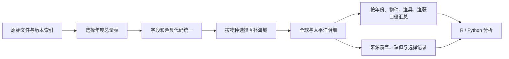

# 年度渔获清洗与合并标准模板

本流程从已保存的原始快照建立可追溯的研究表，供 Python 与 R 共用。默认整理七种主要商业金枪鱼：ALB、BET、SKJ、YFT、PBF、BFT、SBF。其他物种仍保存在各来源的标准化表和完整原始文件中；没有审定地域规则的物种不会自动并入全球表。

## 1. 工作流与目录



1. **入库**：`tuna_update()` 或 `tuna-data update` 下载并登记新版本。更新与清洗是独立步骤；清洗不会隐式联网下载。
2. **固定输入**：开始读取时锁定每个来源的 SHA-256，核对文件校验值。版本锁可以重建同一批输入。
3. **标准化**：仅把明确的年份、重量转为数值；保留原始代码、缺值及每条记录的出处。
4. **选表合并**：按下表选择地域互补的年度名义渔获表。先选正确统计范围，再拼接记录。
5. **分组汇总**：默认保留 `year + species_code + gear_group + catch_basis`，另提供来源、地域分组表。
6. **检查与保存**：记录未映射渔具、缺值、预期来源是否出现、所有输入和输出的校验值。成功后才更新 `latest.json`。

```text
library/
  manifest.json
  raw/                         原始文件与历史版本
  processed/annual/
    latest.json                最近一次成功运行
    <运行时间与唯一编号>/
      standardized/            所用年度表的全部记录及 raw_* 原字段
      global_catch.parquet     按规则选出的全球明细
      pacific_catch.parquet    按规则选出的太平洋明细
      global_by_gear.csv       年份×物种×渔具×渔获口径
      pacific_by_gear.csv
      global_by_source_gear.csv
      pacific_by_source_gear.csv
      global_coverage.csv      预期来源分区的逐年记录覆盖
      pacific_coverage.csv
      *_selection_audit.csv    标准化记录是否进入选定范围、物种和期间
      gear_crosswalk.csv       实际出现的原始代码、统一分类与映射状态
      source_checks.csv        按来源/地域视图/年份/物种/口径的数量检查
      recipe.lock.toml         固定输入版本、期间和配置
      provenance.json          输入/输出校验值、规则代码指纹、运行环境
```

每次运行创建新目录，不覆盖历史分析。原始文件、表格、图形留在私有库；GitHub 只保存代码、模板、文档和合成测试。

## 2. 全球与太平洋的选表规则

| 物种 | 太平洋使用的数据 | 全球额外加入的数据 |
|---|---|---|
| YFT / BET / SKJ | IATTC EPO + WCPFC **WCPO** | IOTC Indian + ICCAT Atlantic |
| ALB | WCPFC **NorthPacific + SouthPacific** | IOTC Indian + ICCAT Atlantic |
| PBF | WCPFC **NorthPacific + SouthPacific** | 无 |
| BFT | 不适用 | ICCAT Atlantic |
| SBF | 当前分渔具模板不提供太平洋分量 | CCSBT 全球分渔具表，仅一次 |

WCPFC 年鉴原始包的七种地域视图有重叠。`WCPFC` 公约区不能简单加到 IATTC EPO；`NorthPacific/SouthPacific` 也不能再加到 `WCPO/EPO`。模板使用年鉴提供的地域视图，不把年度总量按面积或经度比例拆分。对于热带种，采用 EPO 与 WCPO；对于 ALB/PBF，采用覆盖整个太平洋的南、北分区。地域依据见 [WCPFC 年鉴导言与 Figure 1–3](https://www.wcpfc.int/media/818)。

原始 WCPFC ZIP 的 CSV 和 Excel 是对应数据的不同格式，仅读一次 CSV；ICCAT 只读 `Data`，不把 `Pivot` 等重复汇总再加进去。CCSBT 的 `Catch by Flag` 与 `Catch by Gear` 是两张边际表；本模板选分渔具表，保留 `flag_resolution = all_flags`，不生成不存在的船旗×渔具或洋区×渔具交叉记录。

以上为项目的明确分析规则，并非 RFMO 联合发布的官方全球产品。`standardized/` 保留替代视图供核查；**其中所有记录不能直接相加**。

## 3. 渔获口径和原始粒度

| 来源 | 输入表 | `catch_basis` | 说明 |
|---|---|---|---|
| IATTC | CatchByFlagGear | `retained` | 年×旗×渔具×物种；吨；源表 0 表示低于 0.5 t |
| IOTC | RC-SCI | `retained` | 保留渔获的活重当量；保留东西印度洋、船队、渔业和渔具代码 |
| WCPFC | Yearbook raw CSV | `wcpfc_yearbook_reported` | 年鉴报告值；包括部分丢弃重量估计，围网物种组成有订正 |
| ICCAT | Task 1 `Data` | `landings` / `dead_discards` / `post_release_mortality` / 原生其他类型 | 各捕获类型分开；`Qty_t` 已是吨，不再次乘 `CnvFactor` |
| CCSBT | Catch by Gear | `ccsbt_reported_catch` | 全球 SBF 的全重吨数；不能从该表分解旗国或洋区 |

ICCAT 的 FA/LF 等代码保留为 `iccat_FA`、`iccat_LF`，不在未核实含义时合并为登陆量。新增未审定捕获类型会使流程停止，提示更新适配器。WCPFC 官方说明年鉴自 2017 年起纳入丢弃重量估计；模板把整条来源序列标为其报告口径，不推断每个历史单元的丢弃占比。[WCPFC 数据说明](https://www.wcpfc.int/sustainability/scientific-data)、[IATTC 公共数据](https://www.iattc.org/en-US/Data/Public-domain)、[IOTC retained catch](https://iotc.org/data/datasets/latest/NC/SCI)、[ICCAT 数据目录](https://www.iccat.int/en/accesingdb.html)、[CCSBT 源工作簿](https://www.ccsbt.org/userfiles/file/data/GlobalCatch_Flag_Gear.xlsx)。

**全球表表示覆盖全球来源的合并明细，不表示已经得到口径完全一致的“全球保留渔获总量”。** 默认汇总保留 `catch_basis`，`sources` 和 `regions` 列说明每个数值包含的来源与海域。不能把不同口径的行简单相加后称为同口径总量，也不能把只含部分海域的一个口径分组称为全球总量。

主要字段：

| 字段 | 用途 |
|---|---|
| `year`, `species_code`, `species_name` | 年份、FAO 物种代码、英文名称 |
| `source`, `region`, `subregion_raw`, `stock_raw` | 来源、所选地域视图、原始分区及种群 |
| `gear_code_raw`, `gear_label_raw` | 原始渔具代码及源表提供的描述 |
| `gear_mapping_code`, `gear_group` | 用于对照的代码及统一分类；ICCAT 以 GearGrp 对照，同时保留 GearCode |
| `flag_raw`, `flag_name_raw`, `fleet_raw` | 原始旗/船队字段；没有相应维度时为缺失 |
| `flag_key` | 带来源前缀的标识，如 `iattc::JPN`；不是统一 ISO 旗国代码 |
| `catch_type_raw`, `catch_basis`, `catch_tonnes` | 原生捕获类型、口径和重量；单位固定为全重/活重当量吨 |
| `value_status` | `reported`、`missing`，或 IATTC 的 `reported_zero_below_0.5_t` |
| `observation_id`, `source_sha256`, `source_member`, `source_sheet`, `source_row`, `source_column` | 可回溯到具体文件、表、原始行或宽表单元 |
| `raw_*` | 仅在每个来源的标准化文件中：保留读入的全部原字段 |

旗国、船队、租船归属和历史实体的编码并不相同。模板保留来源命名空间，避免将 WCPFC 两位代码、ICCAT 船队代码和 IATTC 复合旗标强行等同。如需跨 RFMO 旗国比较，应另建立含有效期间与依据的旗国对照表。

## 4. 渔具分类与质量规则

常用 `gear_group`：`longline`（延绳钓）、`purse_seine`（围网）、`pole_and_line`（竿钓）、`handline`（手钓）、`troll`（曳绳钓）、`gillnet`（刺网）、`ringnet`、`trap`、`trawl`、`harpoon`、`rod_and_reel` 等。混合渔具单独保留，不强行算作纯延绳钓或刺网。

未核实代码写为 `unmapped:<来源>:<代码>`，并在 `gear_crosswalk.csv` 标记为 `unmapped`；不会删掉，也不会并入 `other`。当前字典在 `src/tuna_data/harmonize.py`。IATTC 定义可核对[官方参考代码](https://www.iattc.org/en-US/Data/Reference-codes)，IOTC 直接保留源表的 `GEAR` 描述；其他映射及未决代码可逐步审定。

需要项目专用映射时，在模板中设置 `gear_overrides = "my_gear_crosswalk.csv"`，CSV 必须具有以下四列，每行有依据：

```csv
source,gear_code,gear_group,evidence
iattc,LL,longline,https://www.iattc.org/en-US/Data/Reference-codes
```

`gear_code` 对应 `gear_mapping_code`，因此 ICCAT 这里填 GearGrp。覆盖表随结果和版本锁保存；原始渔具代码仍在。WCPFC 的近期历史渔具分类调整没有被模板倒推修正；涉及分类变化的趋势需结合年鉴说明检查。

数值和覆盖规则：

- 空白及已识别缺值保留为 NA；未出现的年/渔具/海域不补零。未知数值标记、负重量、重复 ICCAT RecID 或不兼容表结构会报错。
- 汇总 `observed_sum_tonnes` 仅为已观测部分之和；`n_missing > 0` 时，汇总 `catch_tonnes` 为 NA。全组缺失时，部分和也是 NA。
- `all_source_views_present` 只表示该物种、该年所需来源视图都有记录。它不证明每种渔具、船队或所有渔业完整。最新年份若少一个来源，会标为 `FALSE`，不会拿上一年补齐。
- 默认不删除相同数值或相似行；不同细分渔业可以具有相同数值。来源行标识与输入 SHA 用于追踪，不能仅凭年、物种、渔具重复就去重。
- `*_selection_audit.csv` 记录哪些物种、年份、地域视图进入输出；未选择不等于原始记录被删除。

## 5. R 与 Python 调用

R 完整示例：`examples/r_clean_merge.R`。它会保留全球和太平洋明细、分渔具表、延绳钓/围网子集、黄鳍子集及检查结果供继续分析。

```r
Sys.setenv(RETICULATE_PYTHON = path.expand("~/.venvs/tuna-data/bin/python"))
source("/你的代码目录/tuna_data/R/tuna_data.R")
result <- tuna_build(config = "/你的代码目录/tuna_data/templates/annual_catch.toml")
global <- tuna_processed("global_catch", run = result$run_dir)
pacific <- tuna_processed("pacific_catch", run = result$run_dir)
by_gear <- tuna_processed("pacific_by_gear", run = result$run_dir)
ll <- subset(pacific, gear_group == "longline")
yft <- subset(pacific, species_code == "YFT")
annual_yft <- tuna_summarise(yft)
```

Windows 的 Python 路径使用环境中的 `Scripts/python.exe`。如果 Python 已加载另一个环境，先重启 R；只更改数据位置不需要重启。

```python
from tuna_data import Library
from tuna_data.pipeline import build_annual, read_processed
result = build_annual("templates/annual_catch.toml", library=Library())
global_catch = read_processed("global_catch", run=result["run_dir"])
```

```sh
python -m pip install -e '.[excel,parquet]'
tuna-data build --config templates/annual_catch.toml
tuna-data build --config templates/pacific_catch.toml
```

模板可以修改起止年、物种、范围和渔具对照；省略 `end_year` 时保留最新来源年份。`[versions]` 留空使用当前快照；每次运行自动写完整的 `recipe.lock.toml`。固定版本重建时还应保留同一代码版本与依赖；`provenance.json` 的规则代码指纹用于核对。

## 6. Drive、换电脑与 NAS

默认输出到数据根目录下，因此当前使用 Drive 同步库时，结果也保存在其 `processed/annual/` 中。网络同步是否完成由 Drive 客户端决定。NAS 使用已挂载的文件路径：

```r
Sys.setenv(TUNA_DATA_HOME = "/Volumes/NAS/research/tuna-library")
# Windows: Z:/research/tuna-library；Linux: /mnt/lab-nas/tuna-library
result <- tuna_build(config = "/代码目录/tuna_data/templates/annual_catch.toml")
latest <- tuna_processed("pacific_by_gear")
```

换机器时安装接口，再同步/复制完整库即可。现有 `mirror()` 与 `backup()` 管理原始库及索引；派生结果可在新位置重建，或另外复制整个 `processed/`（包括版本锁和校验清单）。本模板的结果内部使用相对路径，整个运行目录可以独立搬移后通过 `run = 新目录` 读取。若 `output = "自定义结果目录"`，后续读取需传该次 `run_dir`；默认的“最新结果”仍按当前库查找。

## 7. 与网格数据、GFW 的关系

这套年度模板不把统计粒度不同的产品混入总量：

| 数据层 | 保留维度 | 后续操作 |
|---|---|---|
| 年度 RFMO 名义渔获 | 年、物种、渔具、来源、可用旗/船队与口径 | 使用本模板 |
| RFMO 网格 catch/effort | 原生月/季、网格、物种、渔具、原始努力量单位 | 各来源单独适配；采样表不能直接代替年度总量 |
| GFW apparent fishing hours | 原生时间、网格、旗、渔具、RFMO 区域、数据版本 | 使用已有 `gfw_hours()` 清洗；按区域分开分析 |

GFW 月度表可以在 R 里调用已有接口：

```r
catalogue <- tuna_catalog()
gfw_catalogue <- subset(catalogue, source == "gfw")
# 先核对所选记录的 request 参数和版本，再读取对应 dataset_id/member。
# cleaner <- reticulate::import("tuna_data.cleaning", convert = TRUE)
# activity <- cleaner$gfw_hours(tuna_read(dataset_id, member = csv_member))
```

完整的选择参数、读取和绘图示例见 `examples/r_quickstart.R`、`examples/r_plot_catch_and_gfw.R`。GFW 是推断捕鱼活动时数，没有直接的物种渔获吨数。RFMO 区域重叠时，合成全球活动层必须从不重叠的空间范围重新汇总；不能将五个 RFMO 报告按区域直接相加，也不能只按网格中心 `distinct()` 就认为消除了边界重叠。[GFW 报告文档](https://api-doc.globalfishingwatch.org/our-apis/documentation/docs/v3/4wings/report)。
